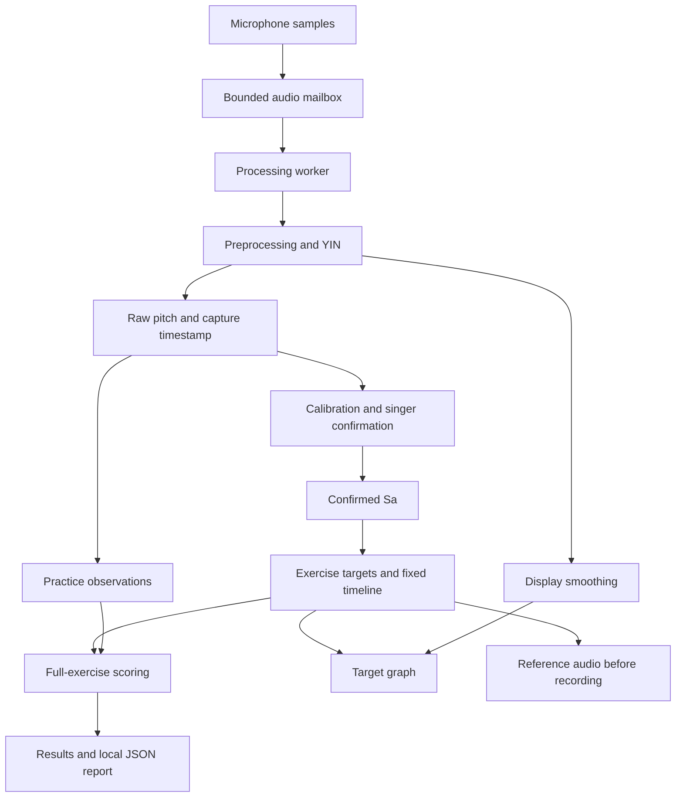

# Architecture

SwarSaathi separates presentation, session coordination, audio processing, and
musical calculations. Views display state, view models coordinate user actions,
and shared models implement the calculations.

## Data flow



The detector has no access to the expected musical note. Target definitions and
microphone observations remain independent throughout practice.

## Audio capture and processing

`PitchEngine` manages microphone permission, the audio session, input capture,
and route changes. It uses the input's actual sample rate and lets the input
node negotiate the tap format.

The callback copies samples to a preallocated, bounded mailbox and signals a
processing worker. Each recording has its own generation identifier. Stopping
invalidates deliveries from that generation so stale frames cannot enter a new
attempt. Packet discontinuities reset pending audio rather than joining samples
across missing intervals.

The default analysis window contains 2,048 samples with a 1,024-sample hop.
Each window is centred by subtracting its mean. RMS measures its signal level;
quiet or invalid input produces no accepted pitch estimate.

## Fundamental-frequency estimation

`YINPitchDetector` compares the waveform with delayed copies using a
constant-length difference calculation. Accelerate/vDSP supplies vector
sum-of-squares and dot products. The normalized difference is searched for the
first suitable local minimum, then refined with parabolic interpolation.

```text
frequency = sample rate / estimated period in samples
```

An accepted frame contains raw frequency, periodicity confidence, RMS level, and
the audio-window centre timestamp. Confidence describes periodicity rather than
a singing score or probability of correctness.

## Calibration

`CalibrationCapture` coordinates recording acceptance and retry decisions.
`CalibrationAnalyzer` checks recorded samples, and `CalibrationSession` manages
the proposed reference and explicit singer confirmation. Exercise selection
does not change confirmed Sa. A separate exercise-availability check validates
the selected targets against the recorded bounds.

## Exercise targets and timing

`MusicTheory.swift` defines the swar ratios and exercise sequences.

```text
target frequency = confirmed Sa × swar ratio
note duration = 60 / BPM
```

`PracticeTimeline` schedules one beat per note. Practice uses elapsed monotonic
time, so targets advance through silence and mistakes. The same target
definitions drive reference playback, the guide, and scoring.

## Graph and live feedback

`PitchGraphView` draws the complete expected phrase on a fixed time axis, with
pitch displayed logarithmically. A moving playhead shows clock progress.
The microphone trace uses a separate display smoother and leaves gaps for
unvoiced observations. Calibration and scoring retain the accepted raw pitch.

Pitch comparison uses musical distance in cents:

```text
cents = 1200 × log2(observed frequency / target frequency)
```

Positive values indicate higher pitch and negative values indicate lower pitch.

## Full-exercise scoring

Each scheduled note is divided into equal cells no longer than 40 milliseconds.
An observation belongs to one cell based on its capture timestamp. When multiple
observations fall in a cell, the closest to its centre is selected without
preferring a successful or reliable observation. Missing or unreliable cells
receive zero credit.

Strict matching uses a ±50-cent tolerance. The practice metric additionally
accepts adjacent-note pitches and the intervening glide within 100 milliseconds
either side of internal note changes. Sustained-note tolerance is unchanged,
and no extra allowance is applied at the exercise's start or end.

```text
per-note match = 100 × matching cells / all scheduled cells for that note
overall match = mean of all scheduled per-note percentages
```

Both strict and practice results are retained. The percentage measures pitch
matching at the selected tempo. Timing and pitch deviations can both affect it.

## Reference playback

`ReferenceSynthesis` generates a mono sine-wave melody from the target timeline,
with short fades to avoid abrupt waveform edges. The samples are encoded as
PCM WAV and played by `ReferencePlayer`. Reference playback stops before
microphone recording begins.

## Reports

The local JSON report stores the target timeline, raw timestamped observations,
thresholds, overall and per-note results, and processing diagnostics. It does
not store the original microphone waveform. `Tools/ReplayReport.swift` can
recalculate results using the saved evidence and production scorer.

## Source map

| Component | Files |
| --- | --- |
| Capture and audio handoff | `PitchEngine.swift`, `AudioPipeline.swift`, `AudioProcessingRun.swift` |
| Pitch estimation and display smoothing | `PitchDetector.swift` |
| Calibration and confirmation | `Calibration.swift`, `CalibrationCapture.swift`, `ScaleViewModel.swift` |
| Musical targets and scoring | `MusicTheory.swift`, `PracticeTimeline.swift` |
| Practice coordination | `PracticeViewModel.swift` |
| Playback | `ReferenceAudio.swift` |
| Interface | `SwarSaathiApp.swift`, `ScaleDiscoveryView.swift`, `PracticeView.swift`, `PitchGraphView.swift`, `SummaryView.swift`, `Theme.swift` |
