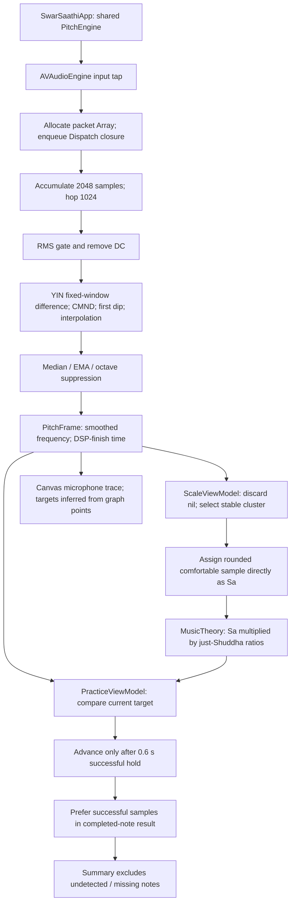
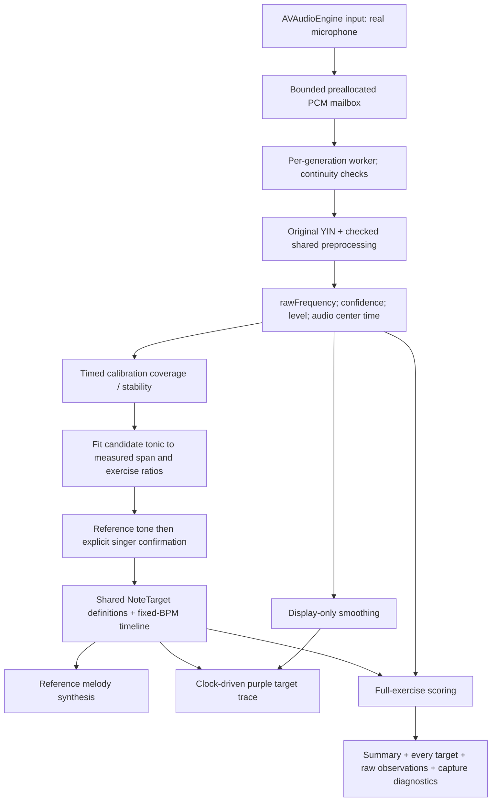

# Swift source audit

Audit date: October 27, 2026. The uploaded ZIP contained eleven Swift files and no Xcode project, app plist, package manifest or tests. All eleven original files were inspected before changes. Original source and the previous repository history were preserved outside the replacement working tree.

## Original data flow

The original tuning and YIN estimator were useful working components. The failures were principally the meaning of the data after detection, target progression and scoring; they did not justify a replacement detector or redesigned app.

## Findings by original file

| Original file | Finding and consequence | Focused correction |
| --- | --- | --- |
| `SwarSaathiApp.swift` | One engine shared between screens; sound ownership model. | Preserve the shared engine and app structure. |
| `PitchDetector.swift` | Constant-window `e0 + eTau - 2 * dotProduct` is a valid YIN difference expression. The smoother returned its old pitch for the first nil frame and delayed real octave changes. No invalid-configuration/buffer-length guard. | Preserve YIN selection/interpolation. Add executable accuracy tests, checked shared preprocessing, raw F0, immediate display gaps for unvoiced input and configuration checks. Keep octave suppression confined to display. |
| `PitchEngine.swift` | Allocated a packet array in the input tap and dispatched one unbounded processing block per packet. Dispatched another unbounded main closure per result. Timestamp reflected DSP completion. Stop did not invalidate queued work. | Preallocated bounded mailbox, isolated processing generation, bounded delivery batches, captured window-center timestamps, explicit stop/join and diagnostics. |
| `ScaleViewModel.swift` | Dropped silent observations before checking reliability; accepted short selected clusters; directly assigned the middle sample to Sa. Permission callback could begin capture after navigation. | Preserve raw timed evidence and missing coverage; range-aware proposal; explicit audition/confirmation; generation guards. |
| `ScaleDiscoveryView.swift` | Three recorded values unlocked practice even when order looked wrong. No reference/confirmation. Claimed a full vocal range from three samples. | Gate practice on a confirmed supported tonic and describe only a measured sample span. |
| `MusicTheory.swift` | Expected frequency already correctly came from Sa × configurable swar ratio. Sixteen-note exercise only. | Retain original tuning, standard exercise and thresholds. Add the selectable five-note exercise and Codable target definitions. |
| `PracticeViewModel.swift` | Successful-hold advancement could stall indefinitely. Auto-completion preferred on-target samples; summary denominator excluded missing notes. Permission completion could start offscreen. | Fixed-BPM monotonic timeline; raw observations scored against all scheduled time cells; incomplete attempts retain the full denominator; lifecycle guards and auditable JSON. |
| `PracticeView.swift` | Manual next-note fallback and success-based progress coupled UI to old progression. No selectable exercise/reference flow. | Preserve card-based visual design; add selection, BPM, reference and clock-based progress. Stop on background/navigation. |
| `PitchGraphView.swift` | Purple targets were grouped from observed graph points; without capture there was no independent target trace. Bands used hardcoded thresholds. | Draw scheduled target segments independently of observations and use configured thresholds. |
| `SummaryView.swift` | Missing notes omitted from detected series and overall score; zero cents could appear when no voice existed. | Present every expected note and coverage; show unavailable deviation as unavailable and explain score limits. |
| `Theme.swift` | Existing reusable visual components and colors. | Preserve. |

## Corrected data flow

Reference playback finishes and stops before microphone recording. No target or generated reference samples populate an observation. The audio callback performs a bounded copy and synchronization; it does not execute YIN or allocate packet arrays/dispatch closures. The mailbox uses short locks, so this is a bounded soft-real-time design, not a lock-free or proven hard-real-time guarantee.

## Calibration and scoring contracts

Calibration summarizes each roughly three-second raw recording, with a documented 300 ms onset/end trim for held-vowel analysis. Within that usable interval it retains silence in coverage, requires at least one second/70%/20 reliable frames and rejects broad pitch movement. A trusted frame supports at most 50 ms. This trim is specific to calibration; practice scoring does not drop note edges.

The measured median extrema, inset by 50 cents, bound trial tonics. Candidates must contain the exercise's actual minimum/maximum ratios. Ranking places the exercise's geometric midpoint near the comfortable-middle sample. A semitone grid referenced to A440 makes the proposal repeatable; the swar ratios remain unchanged. Similar low/middle values are accepted without a mandatory 100-cent separation. Clearly reversed labels beyond measured uncertainty, insufficient span, unreliable or contradictory statistics and unsupported exercises are rejected. Adjustments invalidate prior audition/confirmation.

Practice uses one beat per note, 40–120 BPM, and the same timeline for graph, reference and scoring. Every full note is divided into cells no longer than 40 ms. An observation belongs to one cell based on its captured timestamp; multiple observations are selected by proximity to cell center, never by pitch success. Missing/unreliable cells earn zero. Correct cells satisfy the original ±50-cent threshold. Per-note percentages are averaged over all expected notes. A complete absence of voice therefore scores zero; one correct note in a five-note exercise cannot become 100%.

Timing mismatch and pitch error cannot be uniquely separated by this simple fixed-tempo method. Percentages are experimental pitch-match coverage, not validated Hindustani musical proficiency or detector accuracy.
