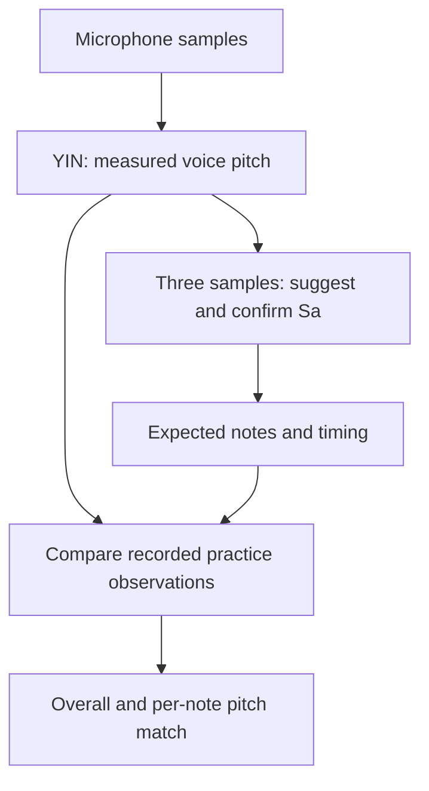

**SwarSaathi — beginner's explanation and evaluator preparation**

Read this guide in order. The first walkthrough explains the user journey and the calculation happening at each step. The presentation script and question table at the end are for rehearsal. A separate [technology-stack description](TECH_STACK.md) is ready to share; the [technical walkthrough](TECHNICAL_WALKTHROUGH.md) contains the full mathematical details.

You can introduce the project with this sentence:

> SwarSaathi helps a learner choose a comfortable starting Sa and practise a short Alankaar by comparing the pitch of their singing with a timed musical guide.

These words are enough to understand the main explanation:

| Word | Plain meaning |
| --- | --- |
| Pitch | How high or low a sound seems. The app estimates its fundamental frequency. |
| Frequency, measured in hertz (Hz) | How many times the sound's repeating pattern occurs each second. |
| Amplitude | The size of the recorded audio signal; it relates to sound level. |
| Sample | One number representing the recorded signal at a particular instant. |
| Sample rate | How many audio samples the device captures each second. |
| Fundamental frequency, or F0 | The repetition frequency associated with the pitch of a voiced sound. |
| Sa, or tonic | The reference pitch from which the exercise's other notes are calculated. |
| BPM | Beats per minute: the exercise's speed. |
| Cents | A unit of musical pitch distance. One equal-tempered semitone is 100 cents. |
| Algorithm | A defined sequence of calculations used to solve a problem. |

1. **The learner opens the app and permits microphone access.**

   iOS requires the user's permission before the app can capture sound. `AVAudioEngine`, part of Apple's AVFoundation framework, receives the microphone's samples. Those samples are amplitude numbers, not note names or frequencies already supplied by the singer.

   A sample rate of 48,000 Hz means 48,000 measurements per second. A sung pitch of 240 Hz means the sound pattern repeats about 240 times per second. These are different quantities.

   The input bar shows an estimate of signal level. It does not show how correct the note is and does not have to fill completely. Background sound can also move it.

2. **The app examines short pieces of sound.**

   The default analysis window contains 2,048 samples. At 48,000 samples per second, this represents about 43 milliseconds of sound. The next analysis begins 1,024 samples later, so successive windows overlap.

   We subtract the average sample value to remove a DC offset, then calculate RMS, a measure of signal level. Very quiet input produces no pitch estimate. This preparation is not a general background-noise-removal system.

   The microphone callback copies samples to a bounded buffer; a separate worker analyzes them. Think of a small waiting tray: it has a fixed capacity, so work cannot accumulate forever. Overflow is counted rather than disguised as real singing. Starting again creates a fresh recording generation, keeping earlier observations out of the new attempt.

3. **YIN measures the voice's fundamental frequency.**

   A steady vowel has a roughly repeating waveform. YIN compares a short waveform with copies shifted by different amounts. A good match suggests how long one repetition takes. It normalizes these comparisons, chooses a suitable minimum and refines its location between whole samples.

   The final relationship is:

   ```text
   Voice frequency = sample rate / repetition period in samples
   ```

   If the sample rate is 48,000 and the period is 200 samples, the estimated pitch is `48,000 / 200 = 240 Hz`.

   The production search range is 70–1,000 Hz. YIN also reports a periodicity confidence. A confidence of 0.90 describes a strongly repeating waveform; it is not a 90% singing score or a measured probability of correctness. A periodic background sound can also be periodic, which is one reason to demonstrate with one singer in a quiet setting.

   The expected Sa/Re/Ga frequency is never fed into YIN. The observed pitch comes independently from microphone samples.

4. **Find My Sa records three comfortable notes.**

   The learner holds an “Aa” at a comfortable low, middle and high pitch. They should not force their lowest or highest possible note. Each sample starts being checked after 3.2 seconds. If the evidence is still inconclusive, the app keeps listening for up to eight seconds rather than rejecting a brief fluctuation immediately.

   One momentary reading is insufficient. The app examines reliable-voice duration, coverage and pitch variation. It explicitly trims 0.3 seconds at each end for onset/offset effects. Inside the remaining interval, missing voice still reduces coverage. It requires at least one second of reliable voice, 70% coverage and 20 accepted observations; the central 80% of accepted pitches must fit within an 80-cent spread.

   The sample's pitch is its median: the middle value after ordering the readings. For readings near `218, 219, 220, 221, 400 Hz`, the median is 220 Hz, so one isolated extreme does not pull the center toward 400 Hz. This example explains the statistic; five readings alone would not pass the recording requirements.

   Consistently unstable or insufficient evidence asks the learner to record again. A similar low and middle pitch is allowed; there is no mandatory 100-cent gap. Clearly contradictory labels or an insufficient total range are rejected.

5. **The app recommends a Sa that fits the exercise.**

   Sa is the starting reference. We need the exercise's other notes to remain inside the range supported by the recordings. Choosing the middle sample directly could put the higher exercise notes outside that range.

   The algorithm places a small margin inside the measured low/high boundaries, finds candidate tonics that fit the exercise, then prefers one that puts the exercise's middle near the measured comfortable middle. Candidate tonics use a semitone grid for reproducibility. The learner can listen, make a permitted adjustment and explicitly confirm.

   For example, measured low/middle/high pitches of 130, 195 and 310 Hz can produce a suggested Sa around 174.61 Hz. The suggestion is informed by the 195 Hz middle sample but is not simply assigned that value.

   This is an exercise-compatible recommendation. Three short vowels cannot establish a uniquely correct lifelong personal Sa or the singer's complete vocal range. Listening to the reference is optional; confirmation is required. A new recording or adjustment invalidates the earlier confirmation.

6. **The confirmed Sa creates the Alankaar targets.**

   The short exercise is **Sa Re Ga Re Sa**. The prototype uses illustrative Shuddha frequency ratios:

   | Note | Calculation | If Sa is 220 Hz |
   | --- | --- | --- |
   | Sa | `Sa × 1` | 220 Hz |
   | Re | `Sa × 9/8` | 247.5 Hz |
   | Ga | `Sa × 5/4` | 275 Hz |

   The expected sequence is therefore `220 → 247.5 → 275 → 247.5 → 220 Hz`. Choosing a different Sa moves the entire exercise while preserving those ratios. The full ascent/descent exercise is also available when it fits the confirmed measured range.

   A Western name such as A3 identifies the reference pitch; the exercise intervals still use the stated ratios. This prototype does not model every raga-specific intonation or ornament.

7. **The learner can listen, then practise at a chosen speed.**

   Reference audio is generated from the same target definitions used by the graph and score. It uses simple sine-wave tones with short fades to avoid abrupt clicks. Reference playback ends before microphone recording begins, helping prevent the app from measuring its own reference as the singer's voice.

   Each note lasts one beat. At 60 BPM, one beat lasts one second, so the five-note exercise lasts five seconds after the three-beat visual count-in. The formula is `seconds per beat = 60 / BPM`.

   A monotonic clock, which measures elapsed time independently of wall-clock changes, determines the target. Wrong notes and silence do not pause the exercise. The timer refreshes the screen; elapsed time decides which note is current.

8. **The live display compares two independent values.**

   The purple guide represents the expected notes. The blue trace represents measured voice pitch. A moving playhead shows time passing from left to right. The target sequence is visible before singing starts.

   Display smoothing makes the blue trace easier to follow. It can introduce visual delay, so the scoring and Sa recommendation use the raw accepted YIN pitches instead. Missing pitch creates a gap; the graph does not invent a note during silence.

   We compare measured and expected frequency using cents:

   ```text
   Pitch error in cents = 1200 × log2(measured frequency / expected frequency)
   ```

   Equal frequencies give zero error. Positive error means too high; negative error means too low. Cents are useful because musical intervals depend on frequency ratios: the same difference in hertz has a different musical meaning at a low pitch and a high pitch.

9. **The score includes the complete expected exercise.**

   Each note is divided into small time cells no longer than 40 milliseconds. A cell receives credit when its real, reliable microphone observation matches the expected pitch under the scoring rules. An absent, unreliable or wrong observation earns zero. If several observations are in one cell, the closest to the cell's center is used without choosing whichever gives a better score.

   The held-note tolerance is ±50 cents. The displayed practice metric also allows a small transition: within 100 milliseconds either side of an internal note change, a pitch between the adjacent notes, including their normal tolerance bands, can qualify. Silence is not credited during this allowance. There is no extra grace at the exercise's beginning or end.

   ```text
   Per-note pitch match = 100 × matching cells / all expected cells for that note
   Overall pitch match = average across ALL expected notes
   ```

   At 60 BPM, each one-second note has 25 cells. Five notes have 125 cells. If 100 qualify, the overall score is 80%. Singing four notes perfectly and missing the entire fifth is also 80%, not 100%. Stopping early leaves the uncompleted portion in the denominator.

   The original strict score, which has no adjacent-note transition allowance, remains available in Details and the report. The boxes show each note's pitch-match result. The overall score measures matching within this timed exercise; it does not grade the singer's expression, breath control, musical knowledge or complete musicianship. Timing mismatch and device delay can also affect it.

10. **The result can be inspected and reproduced.**

    The result screen shows one overall percentage and the individual note boxes. Technical information is under Details. Share report exports JSON: a structured text file containing the observed frequencies, their timestamps and confidence, expected targets, scoring settings, results and diagnostics.

    JSON contains numerical observations, not the original recorded singing waveform. Replaying it through the scorer checks score arithmetic, but cannot prove that every estimated pitch equals the actual acoustic pitch. That requires a real audio recording and independent reference analysis.

    All analysis runs on the phone or iPad. Internet is unnecessary after the native app is installed. GitHub stores source code and automated build results; it is not processing the singer's audio.

The relationship between the two pitch paths is:



You can describe the implementation organization simply: **SwiftUI draws the screens, view models coordinate the steps, and the shared calculation code measures pitch and scores it.** This is an MVVM-style architecture: Model, View, ViewModel. A framework is a collection of reusable platform facilities; an algorithm is the sequence of mathematical steps. SwiftUI and AVFoundation are frameworks. YIN is an algorithm. Swift is the programming language, and Xcode is the development environment.

**What the existing tests establish:** application revision `38b52e1` passed 75 automated portable regression tests. Apple core tests and iOS Simulator compilation also passed in [CI](https://github.com/Aniruddh2708/swarsaathi-prototype/actions/runs/40626528026). The tests include known tones, harmonics, noise, silence, octave transitions, calibration validity, queue behavior and scoring mistakes. The new calibration integration test processed 24 synthetic vowels through the actual shared worker/YIN; the maximum error of the sample medians was 0.672 cents. All eight tested sets produced the same tonic as the corresponding known-frequency inputs under the implemented fitting rule. Independent scoring fixtures and JSON replay verified the arithmetic.

These are specific synthetic and software results. They do not establish near-perfect accuracy on real singers, real-device microphone reliability, or a unique personal Sa. Reports from informal user trials are useful debugging evidence, but a quantified real-singing accuracy claim needs independently annotated recordings and a stated device/test procedure. No new hardware validation is claimed by this guide.

For a short live demonstration, use this sequence:

1. Open the installed app on the actual iPhone/iPad and allow microphone access. Use a quiet setting and the microphone route already rehearsed.
2. Record comfortable low, middle and high vowels. Explain that the input bar shows sound level and that the app checks consistency over time.
3. Show the suggested Sa. Listen if helpful, confirm it, then select Sa Re Ga Re Sa at 60 BPM.
4. Play the reference if helpful, then start practice. Explain the count-in, target guide and independent blue voice trace.
5. Finish the phrase and show the overall result and note boxes. Explain that the result measures pitch matching in this timed exercise.
6. Run another attempt and deliberately miss a full note. Its score should be zero and the full-exercise score should decrease. Other notes need not be perfect, so do not promise a particular total in a live trial.
7. Open Details and share the report if the evaluator wants evidence behind the numbers.

Rehearse the complete sequence before the presentation. If a recording fails, show the retry behavior and explain the evidence requirement. Do not substitute generated audio for live singing without clearly labeling the demonstration.

You can use this approximately one-minute introduction:

> SwarSaathi is a native iPhone and iPad prototype for singing-pitch practice. First, the learner records comfortable low, middle and high vowels. We capture microphone samples with AVAudioEngine and use YIN to estimate how often the waveform repeats, which gives us its fundamental frequency. We check whether each sample contains enough consistent voice, then suggest a Sa that allows the exercise to fit within the measured range. The learner confirms that starting note. During practice, a clock advances Sa Re Ga Re Sa at the selected tempo while we independently measure the microphone pitch. We compare the two in cents and score the complete exercise, including wrong or missing notes, with a small allowance for note transitions. The result shows overall and per-note pitch matching. Processing happens on the device, and reports make the calculation reproducible. Our automated tests validate the algorithm and scoring; measured accuracy on real singers remains a separate validation stage.

Likely evaluator questions and short answers:

| Question | Answer |
| --- | --- |
| Is this AI? | The current prototype uses deterministic digital signal processing and rules. It has no trained machine-learning model. |
| What does YIN receive? | Audio amplitude samples and the sample rate. It estimates pitch without knowing the expected musical note. |
| Why choose YIN? | It looks for the repeating period of a single voiced sound and can handle harmonic-rich vowels. It is suitable for this focused prototype, though real voices can still produce errors. |
| Are you using an FFT to pick the loudest frequency? | No. This implementation uses YIN's time-domain difference calculation, accelerated with vector operations on Apple hardware. |
| Why not use the middle sample directly as Sa? | We also need the entire exercise to fit the measured range. The middle sample guides the ranking of fitting candidates. |
| Is Sa fixed for a person? | This app recommends a comfortable starting point for an exercise. It does not prove a permanent personal tonic. |
| Does a 0.9 confidence mean 90% singing accuracy? | No. Confidence measures waveform periodicity; pitch match measures agreement with the exercise; voice coverage measures reliable input over time. |
| Why can a trained singer score below 100%? | The metric includes timing and missing/rejected observations, uses specific illustrative tuning, and does not measure complete musicianship. |
| How do you avoid inflated scores? | Every scheduled note and time cell stays in the denominator; missing voice earns zero; targets never become microphone observations; raw evidence is exportable. |
| How much tolerance is allowed? | ±50 cents for sustained matching, plus up to 100 ms either side of internal note changes for the practice metric. The strict metric is retained. These are explicit prototype policies. |
| Does it work without internet? | Yes, after the native app is installed. Analysis and report storage are local. |
| Have you proven near-perfect accuracy? | No. We can state measured errors on the named synthetic tests and show passing software checks. Real-singer accuracy needs independently annotated device recordings. |
| What would you improve next? | Validate a diverse set of real singers, quantify octave/voicing errors and device latency, evaluate tonic comfort with singers/teachers, and tune the practice experience based on that evidence. |

Use the [shareable stack description](TECH_STACK.md) in your report. Keep the [complete formulas and source map](TECHNICAL_WALKTHROUGH.md) available for deeper questions.
