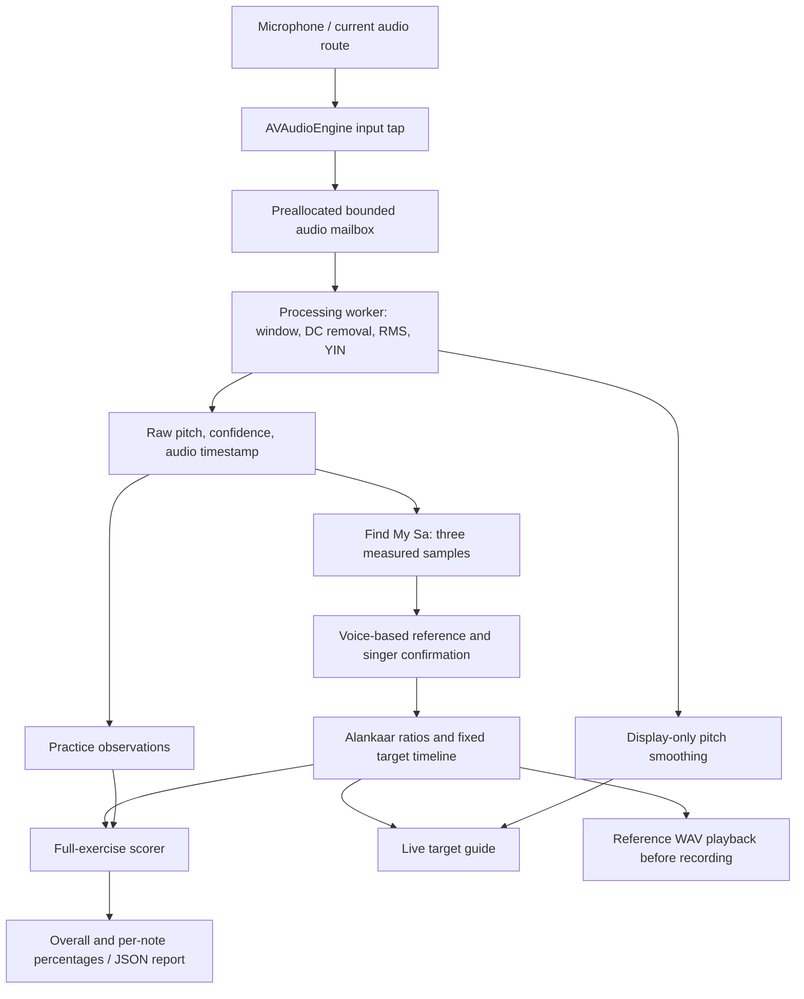

# SwarSaathi: technical walkthrough for the feasibility demonstration

This document describes the implementation in this repository, including the
interface simplification of October 28, 2026. It is intended for an evaluator or
developer; the app itself keeps these details out of the normal singing flow.

SwarSaathi is a native iPhone/iPad application that estimates a single singer's
pitch, suggests a singer-confirmed Sa from three recorded vowels independently of exercises, and
compares microphone observations with a timed Alankaar. The result is a measured
**pitch-match percentage for the scheduled exercise**. It is not a probability
that the singer is musically correct, a raga recognizer, or a measurement of a
unique permanent personal Sa.

## 1. Technology stack and responsibilities

| Technology | How this prototype uses it |
| --- | --- |
| Swift | Application logic, signal processing, musical calculations, state machines and tests. The project uses Swift 5 language mode; the package declares Swift tools 5.9. A newer Swift compiler can build that language mode. |
| SwiftUI | Screens, navigation, reactive updates, controls, percentage cards, sharing and the live graph. `Canvas`, `Path` and `TimelineView` draw the live guide. |
| AVFoundation | `AVAudioEngine` captures audio; its input-node tap receives sample buffers. `AVAudioSession` configures recording/playback and handles route/interrupt notifications. `AVAudioPlayer` plays the generated reference WAV. `AVAudioApplication` requests microphone permission on iOS 17+. |
| Accelerate / vDSP | Apple-optimized vector sum-of-squares and dot products for the original YIN difference calculation. Portable tests use scalar equivalents of those same operations on Linux. |
| Foundation | `Codable` JSON reports, local files, timers, notifications, locks and the worker thread. |
| Dispatch | Semaphores wake the processing worker; `DispatchTime` measures processing duration. |
| QuartzCore | `CACurrentMediaTime()` supplies the monotonic host clock used for exercise timing and timestamp fallback. |
| UIKit | Settings navigation, optional note-change haptics, and keeping the display awake during practice. |
| XCTest + Swift Package Manager | Repeatable tests of the shared detector, calibration, timing, scoring and audio handoff code. There are no external package dependencies. |
| Xcode + GitHub Actions | Builds the native app. CI on `macos-15` runs core tests on the Apple Accelerate path and builds an unsigned iOS Simulator application. |

The deployment target is **iOS/iPadOS 17.0 or newer**, with iPhone and iPad device
families enabled. The package's macOS support is for the shared core/test target;
this repository does not configure a Mac Catalyst application. `App/Info.plist`
declares the microphone usage explanation and local document sharing.

The current app contains no Python runtime, web frontend, server API, cloud
inference, database, or trained machine-learning model. Analysis runs locally;
an installed app can perform this demo without an Internet connection. GitHub
hosts the source and CI, not the live microphone analysis. Exporting a report is
an explicit user action.

## 2. Architecture and complete data flow

The structure follows a small MVVM design: views display state, view models
coordinate user actions and audio lifecycle, and pure models implement the
calculations. One `PitchEngine` is shared between calibration and practice.



The expected timeline never supplies the detected frequency. The microphone
worker produces `rawFrequency` without knowing which note is expected.
Calibration and scoring use that raw estimate; the graph uses a separately
smoothed display value.

| Source file | Responsibility |
| --- | --- |
| `SwarSaathiApp.swift` | Creates the shared engine and root navigation. |
| `PitchEngine.swift` | Permission, recording session, native input tap, timestamps, delivery timer, route handling and stop/start. |
| `AudioPipeline.swift` | Bounded audio mailbox and bounded output-frame buffer. |
| `AudioProcessingRun.swift` | One isolated processing generation, overlapping windows, detector calls, smoothing and diagnostics. |
| `PitchDetector.swift` | Configuration, DC/RMS preprocessing, YIN and display smoothing. |
| `CalibrationCapture.swift` | Collect/accept/reject decisions over the recording interval. |
| `Calibration.swift` | Sample statistics, validity checks, voice-only reference suggestion and explicit Sa confirmation. |
| `ScaleViewModel.swift`, `ScaleDiscoveryView.swift` | Coordinate and display the low/middle/high recording flow. |
| `MusicTheory.swift` | Swar ratios, exercises, cents arithmetic and reference note names. |
| `PracticeTimeline.swift` | Clocked targets, full-exercise scoring and reference-wave synthesis. |
| `ReferenceAudio.swift` | Reference playback and interruptions. |
| `PracticeViewModel.swift`, `PracticeView.swift` | Count-in, practice state, microphone observations, live feedback and controls. |
| `PitchGraphView.swift` | Fixed left-to-right live target guide and measured display trace. |
| `SummaryView.swift`, `Theme.swift` | Result presentation and shared visual components. |

## 3. Capturing audio without building an unlimited backlog

Before recording, the engine selects the audio-session category `.record` and
mode `.measurement`, activates it, and queries the actual input format. It asks
the input node to negotiate the tap format by passing `format: nil`; it does not
force a cached 44.1 kHz format onto a newly selected device. The requested tap
buffer size is 1024 samples, but actual callback sizes can differ.

The detector uses the **actual hardware sample rate**. The tap reads the first
Float32 channel. A buffer with a different sample rate is not processed using
the old rate. Route/configuration changes terminate the current attempt so the
user can retry with the new input. This matters for AirPods and Simulator route
changes; code changes alone do not prove that every physical route is validated.

The audio callback copies samples into an eight-slot preallocated mailbox, with
up to 8192 samples per slot, and signals a worker. It does not run YIN, create an
array for every packet, or enqueue an unlimited number of dispatch closures.
If the mailbox is full, that packet is dropped and counted. The worker-to-UI
buffer has capacity 128 frames. A main-run-loop timer drains it at about 30 Hz.

These queues use brief `NSLock` sections. This is a bounded soft-real-time design,
not a lock-free or hard-real-time guarantee. Some worker-side arrays still shift
or allocate; they are outside the tap. Device profiling remains necessary.

Every start creates a new processing generation. Stop invalidates delivery,
removes the tap, stops the engine, and gives the worker a bounded two-second join.
An old worker retains its own memory and cannot deliver observations into the
next attempt. Packet-time discontinuities greater than two sample periods reset
pending audio and smoothing instead of joining audio across a missing segment.

## 4. Time, windows and signal preparation

The production defaults are:

| Parameter | Value |
| --- | --- |
| Searched fundamental range | 70–1000 Hz |
| Analysis frame | 2048 samples |
| Hop between frames | 1024 samples; 50% overlap |
| RMS silence gate | 0.008 in normalized sample units |
| Minimum YIN confidence | 0.85 |
| YIN dip threshold | 0.15, equal to `1 − 0.85` |

At 48 kHz, a frame spans `2048/48000 = 42.667 ms`, and the hop is `21.333 ms`.
At 44.1 kHz, those values are `46.440 ms` and `23.220 ms`. Tests also exercise
4096-sample detector configurations; the native app currently defaults to 2048.

AVAudioTime's host timestamp supplies the start time of each captured packet.
When it is unavailable, the code uses `CACurrentMediaTime() − packetDuration`
and increments a fallback counter. Each analyzed frame is timestamped at its
**sample-window center**:

```text
t_center = t_firstSample + N / (2 × sampleRate)
```

It is not timestamped when the computation finishes. This keeps worker execution
delay from being mistaken for the time at which the singer produced the sound.
It cannot remove the device's acoustic/input buffering delay.

For a frame `x[0 ... N−1]`, the shared preprocessing is:

```text
mean = sum(x[n]) / N
y[n] = x[n] − mean
RMS = sqrt(sum(y[n]²) / N)
```

Subtracting the mean removes the frame's DC offset. If RMS is below 0.008,
the frame is unvoiced and has no pitch. Nonfinite samples, invalid configuration
or undersized input also produce no pitch. The displayed level bar uses roughly
`min(1, sqrt(RMS / 0.15))`; it indicates sound level, not correctness. It need not
be full, and ambient sound can also move it. No calibrated decibel measurement
is claimed.

## 5. YIN fundamental-frequency estimation

YIN is a time-domain periodicity estimator described by de Cheveigné and
Kawahara (2002). A voiced vowel usually contains several harmonics; simply
selecting the loudest frequency component can mistake a harmonic for the
fundamental. YIN searches for the repeating period of the waveform.

### Difference calculation

For sample rate `Fs`, the implementation defines:

```text
tauMin = max(2, floor(Fs / 1000))
tauMax = floor(Fs / 70)
W = frameSize − tauMax − 1

d(tau) = sum from j=0 to W−1 of (y[j] − y[j+tau])²
```

`W` is constant for every candidate lag. At 48 kHz, `tauMax = 685` and
`W = 1362`; at 44.1 kHz, they are 630 and 1417. Configuration validation ensures
that the shifted windows and interpolation neighbors fit in the input frame.

The original implementation computes the mathematically equivalent form:

```text
E0 = sum(y[j]²)
E_tau = sum(y[j+tau]²)
R(tau) = sum(y[j] × y[j+tau])
d(tau) = max(0, E0 + E_tau − 2 × R(tau))
```

`vDSP_svesq` obtains the initial energy and `vDSP_dotpr` obtains each dot product.
The shifted energy is updated by removing the old first sample's square and
adding the new last sample's square. The nonnegative clamp handles small
floating-point cancellation errors. There is no FFT-based pitch selection here.

### Cumulative mean normalized difference

The normalization is:

```text
CMND(0) = 1
CMND(tau) = d(tau) × tau / sum from k=1 to tau of d(k)
```

If the cumulative denominator is zero, the implementation uses 1. A small CMND
value indicates a strong repeating period. Starting at `tauMin`, the detector
finds the first dip below 0.15 and descends to that dip's local minimum. Choosing
the first qualifying dip helps avoid selecting a multiple of the period, which
would produce an octave-too-low estimate. It does not eliminate every octave
error for every real voice.

### Sub-sample interpolation and frequency

Let `a`, `b`, and `c` be CMND at the minimum's left neighbor, minimum and right
neighbor. The detector fits the local parabola:

```text
delta = (a − c) / (2 × (a + c − 2b))
estimatedPeriod = integerMinimumLag + delta
estimatedFrequency = Fs / estimatedPeriod
confidence = 1 − clamp(b, 0, 1)
```

Interpolation is omitted when its denominator is effectively zero. A result
must be finite, within the configured frequency range, and meet the confidence
gate. Otherwise it remains absent.

**A confidence of 0.90 means the selected CMND minimum is approximately 0.10.**
It is a periodicity measure. It does not mean “90% chance of the correct note,”
“90% singing accuracy,” or independently established detector accuracy.

### Display smoothing is a separate branch

The graph's pitch uses a median of up to five recent values followed by an
exponential moving average in log-frequency space:

```text
display = 2 ^ (log2(previousDisplay)
              + 0.65 × (log2(currentMedian) − log2(previousDisplay)))
```

With sufficient history, a near-one-octave jump (within 70 cents of 1200 cents)
must persist for four frames before the smoother accepts it. An unvoiced frame
immediately produces a graph gap; three missing frames clear the history.
Smoothing can make a visual transition lag. It never changes the raw pitch used
to recommend Sa or calculate the score.

## 6. Find My Sa: evidence, validation and recommendation

The singer records comfortable low, middle and high vowels. The system starts
evaluating after 3.2 seconds and checks every 0.4 seconds. If a sample is not yet
conclusive, it keeps collecting until acceptance, an explicit stop, or the
eight-second limit. Timer scheduling can make the actual finish slightly later.
One brief fluctuation therefore does not immediately abort the recording.

### Accepting a recorded sample

Each evaluation considers the current recording, rather than searching for a
short successful excerpt. There is an explicit 0.3-second trim at each edge for
onset/offset effects. The recording bounds remain known, so absence inside the
remaining interval still reduces coverage.

A reliable observation has a finite positive frequency and confidence between
0.85 and 1. The interval represented by one observation is based on the median
timestamp spacing, capped at 50 ms. The algorithm unions these intervals, clipped
to the usable recording interval, so sparse or duplicate observations cannot
pretend to represent several seconds of sustained singing.

```text
usableDuration = recordingDuration − 0.6 seconds
coverage = reliablyVoicedDuration / usableDuration
```

Acceptance requires at least 20 reliable observations, at least one reliably
voiced second, at least 70% coverage, and sufficiently stable pitch. For accepted
frequencies `f_i`:

```text
samplePitch = median(f_i)
c_i = 1200 × log2(f_i / samplePitch)
spread = percentile90(c_i) − percentile10(c_i)
stability = 1.4826 × median(abs(c_i − median(c_i)))
```

The central 80% spread must be at most 80 cents. The median and robust spread
tolerate occasional outliers and ordinary small vibrato; persistent large
variation fails. The stability statistic is retained for diagnostics. These
thresholds are explicit prototype assumptions, not validated clinical limits.

### Checking the three samples

The recommendation verifies finite values and internally consistent statistics,
including `coverage = voicedSeconds / usableSeconds`. Clearly reversed
low/middle/high labels are rejected. For each earlier/later pair, a reversal is
allowed only up to:

```text
5 cents + (earlierSpread + laterSpread) / 2
```

This accommodates overlapping measurement uncertainty. There is **no requirement
that low and middle differ by 100 cents**. Similar samples can be valid, but they
provide little additional evidence about range. A measured range must support a reference pitch within its inset boundaries; it need not contain any particular exercise.

### Suggesting Sa independently of any exercise

Calibration accepts only the three voice samples. Its API has no exercise or tuning
argument. The old exercise-midpoint fit is removed as of October 29: changing an
Alankaar must not redefine the singer's reference pitch or invalidate good voice
measurements. Ga's 1.25 ratio is used later only when building an exercise.

Three vowels cannot determine a unique personal Sa. The app provides a disclosed
starting-reference heuristic, then requires the singer's confirmation. Let `L`,
`M`, and `H` be the measured medians. Retain the existing 50-cent inner margins:

```text
lowerBoundary = min(L, M, H) × 2^(50/1200)
upperBoundary = max(L, M, H) × 2^(−50/1200)
rangeCenter = sqrt(lowerBoundary × upperBoundary)
preferredSa = sqrt(rangeCenter × M)
```

Geometric means take the midpoint in logarithmic musical pitch. The preferred
reference gives equal weight to the measured range center and the self-reported
comfortable middle in that space. This is an explicit prototype preference, not
a physiological law or validated formula for a uniquely correct tonic. It is
not merely an assignment of M, and it uses no exercise ratios.

The implementation computes these means in log space to avoid multiplying large
floating-point values. It searches fitting semitone-grid references within the
recorded boundaries:

```text
candidate(midi) = 440 × 2^((midi − 69)/12)
cost(candidate) = abs(1200 × log2(candidate / preferredSa))
```

Candidates within five cents of the best cost are treated as close, with the
lower chosen consistently. For 130 / 195 / 310 Hz, boundaries are approximately
133.81–301.17 Hz, range center 200.75 Hz, preferred reference 197.85 Hz and selected
reference G3 ≈ 196.00 Hz. The previous five-note-specific F3 ≈ 174.61 Hz example
is superseded. A range without a fitting grid reference is still inconclusive.

After confirmation, `Alankaar.fits` generates every target at the fixed Sa and
checks its actual frequency against the same recorded boundaries. It checks
notes below Sa as well as high notes, rejects incomplete/invalid definitions,
and has no ability to change Sa. Every available exercise remains visible;
recording/reference playback is blocked when that selected exercise extends
outside the range, with an instruction to choose another or explicitly adjust
Sa. A larger exercise does not invalidate calibration.

Calibration diagnostic schema version 2 records `selectionMethod`, `rangeCenterHz`
and `preferredSaHz`, replacing the obsolete exercise min/max-ratio fields.
Manual adjustment is permitted for the reference itself within the recorded
boundaries and always invalidates confirmation; exercise availability is then
checked separately. This does not guarantee all exercises fit one tonic.

### Confirmation

The singer can play a reference tone, adjust the suggestion within the same
measured boundaries, and explicitly confirm it. Listening is optional. Starting
capture stops reference playback. Any new calibration or manual change
invalidates the previous confirmation; practice cannot silently reuse it.

## 7. Musical targets and fixed progression

Targets are generated from the same musical definitions for scoring, the graph
and reference playback:

```text
expectedFrequency = confirmedSa × swarRatio
```

| Swar | Ratio | Frequency when Sa is 220 Hz |
| --- | --- | --- |
| Sa | 1 | 220 Hz |
| Re | 9/8 | 247.5 Hz |
| Ga | 5/4 | 275 Hz |
| Ma | 4/3 | 293.333… Hz |
| Pa | 3/2 | 330 Hz |
| Dha | 5/3 | 366.666… Hz |
| Ni | 15/8 | 412.5 Hz |
| Upper Sa | 2 | 440 Hz |

These are illustrative just-intonation-style Shuddha ratios. They do not model
every raga-dependent intonation or ornament. The short exercise is **Sa Re Ga Re
Sa**. The original 16-note ascent/descent is also selectable. Recording is enabled only when all selected targets fit the recorded range at the same confirmed Sa.

Tempo is selectable from 40 to 120 BPM, with a default of 72 and one beat per
note. There is a three-beat visual count-in. For zero-based note index `i`:

```text
beatDuration = 60 / BPM
noteStart(i) = i × beatDuration
noteEnd(i) = (i + 1) × beatDuration
elapsed = monotonicNow − sessionStart
currentIndex = floor(elapsed / beatDuration)
```

The clock advances during correct notes, mistakes and silence. A timer refreshes
the UI, but the target is determined from elapsed monotonic time rather than
from how many callbacks have occurred. It never waits for a correct note before
moving on. The practice run ends 200 ms after its scheduled duration to allow
already captured frames to arrive; observations at or beyond the scheduled end
still cannot score.

## 8. What the percentages mean and how they are calculated

Pitch error uses cents, a logarithmic interval unit:

```text
centsError = 1200 × log2(detectedFrequency / expectedFrequency)
```

Positive is high; negative is low. An octave is 1200 cents, and an equal-tempered
semitone is 100 cents. The current sustained-note bands are ±25 cents for “very
accurate” feedback and **±50 cents for accepted pitch matching**. Around 220 Hz,
±50 cents corresponds to approximately 213.74–226.45 Hz. The score is binary per
time cell; it does not give a greater numeric reward for 0 cents than 20 cents.

### Full-exercise denominator

For each scheduled note of duration `D`, the scorer creates:

```text
cellCount = ceil(D / 0.040 seconds)
cellWidth = D / cellCount
```

The code includes a tiny numerical adjustment when applying `ceil` to avoid an
extra cell caused only by floating-point arithmetic. Each cell spans at most
40 ms. The exercise's complete scheduled duration is represented, including
note beginnings, endings and notes after an early stop.

Each raw observation belongs to one cell according to its audio timestamp.
Duplicate timestamps count once. If several observations occupy a cell, the
closest to the cell midpoint is selected **before judging its pitch**. A good
observation cannot replace a closer bad, silent or low-confidence one. A cell
without a reliable observation earns zero.

For note `i`, let `N_i` be expected cells, `V_i` reliable voiced cells, `C_i`
strictly correct cells, and `T_i` additional cells accepted by the transition
policy:

```text
strictNotePercent(i) = 100 × C_i / N_i
practiceNotePercent(i) = 100 × (C_i + T_i) / N_i

overallStrictPercent = mean(strictNotePercent(i), over ALL expected notes)
overallPracticePercent = mean(practiceNotePercent(i), over ALL expected notes)

voicedDuration(i) = noteDuration(i) × V_i / N_i
voiceCoveragePercent = 100 × sum(voicedDuration(i)) / sum(noteDuration(i))
```

All current notes have equal duration. The implementation explicitly uses equal
note weighting, so if variable-duration notes are added later that policy must
be reviewed. Report field names such as `expectedFrames` and `correctFrames`
refer to these scoring cells, not necessarily the count of raw YIN callbacks.

The displayed **Pitch match** and per-note boxes use `practiceMatchPercent`.
The JSON retains unrounded values; the simplified interface rounds to one
decimal place. The strict metric remains `accuracyPercent`. Neither is YIN's
confidence or the percentage of successful notes only.

### Transition allowance

Within 100 ms on either side of an internal note change, the practice metric
accepts reliable frequencies between the two adjacent target pitches, including
their existing ±50-cent outer bands. This accommodates a small early/late
transition or glide. The general formula is `min(0.1, 0.2 × 60/BPM)` seconds;
through the current 40–120 BPM range it is 100 ms.

The allowance does not omit time from the denominator, create a microphone
observation, shift the recording globally, or widen the held-note band. Silence,
low-confidence observations and wrong octaves still earn zero. There is no
additional start-of-exercise or end-of-exercise grace. The original strict
result remains available for comparison and audit.

### Worked score example

At 60 BPM, five one-second notes produce 25 cells each: 125 expected cells.
Suppose there are 70 strictly correct cells, four additional valid transition
cells, and 102 reliably voiced cells:

```text
Strict pitch match = 70 / 125 × 100 = 56.0%
Practice pitch match = 74 / 125 × 100 = 59.2%
Reliable voice coverage = 102 / 125 × 100 = 81.6%
```

The score audit fixture independently constructs exactly these counts and
verifies them. High voice coverage does not imply correct pitch: the person can
be clearly audible while singing the wrong note. Conversely, an absent pitch
can reflect silence, rejected periodicity or dropped input; the report must be
inspected before attributing it solely to singing technique.

## 9. Reference playback and visual feedback

`ReferenceSynthesis` generates a simple sine for each scheduled target:

```text
sample[n] = 0.2 × envelope[n] × sin(2π × targetFrequency × n/Fs)
```

Each note has up to 10 ms linear fades at its ends to reduce clicks. The default
reference rate is 44.1 kHz. Samples are encoded as mono 16-bit little-endian PCM
in a RIFF/WAV container, then played by `AVAudioPlayer`. The Sa reference is one
note at 40 BPM, lasting 1.5 seconds. This synthesized reference is clearly
separate from microphone observations.

The entire expected phrase is drawn before practice on a fixed left-to-right
time axis. Vertical position is logarithmic in frequency, so equal musical
intervals have equal height. Purple segments and bands show targets, the blue
line shows display-smoothed input, and a playhead shows elapsed time. Missing
pitch produces a gap. The graph is guidance; the raw timestamped observations
determine percentages.

The post-analysis chart is removed in the simplified interface. A single median
point per note cannot show all timing errors, silence or fluctuations, and can
look inconsistent with a full-duration score. The result screen instead keeps
one overall score and the useful note-by-note percentage boxes. Technical
details and report sharing are optional. Short retry messages replace technical
error paragraphs; diagnostic evidence remains available for development.

## 10. Reproducibility, validation and limits

Practice JSON stores the target timeline, confirmed Sa, BPM, thresholds, raw
observations with time/frequency/confidence, all per-note results, strict and
practice scores, transition counts, and capture diagnostics. It also marks an
incomplete attempt and its reason. Calibration reports retain observations,
sample statistics, recording durations, recommendation and confirmation.
The JSON contains pitch evidence, **not the original recorded audio waveform**.

The report replayer invokes the production scorer:

```sh
sh scripts/replay_report.sh path/to/practice.json
```

It can verify arithmetic against the recorded observations. It cannot establish
that those observed frequencies were the true acoustic fundamental; that needs
real audio and an independent reference analysis.

Run the shared regression suite with:

```sh
sh scripts/test.sh
```

On a Mac, also compile the application:

```sh
xcodebuild -project SwarSaathi.xcodeproj -scheme SwarSaathi \
  -configuration Debug -destination 'generic/platform=iOS Simulator' \
  -derivedDataPath .build/xcode CODE_SIGNING_ALLOWED=NO build
```

Tests include deterministic known-frequency sine waves, harmonic-rich vowels,
noise/DC offsets, silence, octave transitions, bounded-queue behavior,
generation/reset isolation, sample validity, tonic range fit, fixed progression,
wrong/missing notes, transition limits and JSON replay. Integration tests send
synthetic PCM through the same preprocessing worker/YIN path used by capture.
Test inputs are explicitly synthetic and are never presented as live singing.

The recorded clean-tone baseline measured a maximum absolute error of
**0.438624 cents across 44 cases**, with a median of **0.022117 cents**. That is
a numerical result on the specified deterministic test set, not a “99.9% accurate
on singers” claim. Current run counts, new integration measurements, failures,
CI results and evidence logs are maintained in [VALIDATION.md](VALIDATION.md).

The October 28 core run passed **75 XCTest tests with zero failures in 4.613
seconds**; see [the actual test log](evidence/clarity-core.log). The new calibration
integration covers 24 synthetic vowels from 82.41 to 620 Hz at 44.1/48 kHz, with
three harmonics, deterministic noise, DC offset and ±20-cent, 5 Hz vibrato. It
passes those PCM samples through the shared worker and YIN pipeline. The maximum
error of the resulting sample medians was **0.671688 cents**, the median error
was **0.201727 cents**, and minimum reliable coverage was **99.282%**. All eight
three-vowel sets produced the same tonic as the corresponding known-input
recommendation under the then-current exercise-fitting rule. That fitting rule
is superseded by the October 29 voice-only recommendation. The latest 85-test run
again matches all eight measured and known-input voice-only recommendations; it does not prove a uniquely
correct tonic for a real singer.

The same run verifies the hand-counted 56.0% strict / 59.2% practice / 81.6%
coverage example above and exact JSON score replay. Detector computation over
500 Linux calls measured **0.607471 ms median / 1.886551 ms p95** on that run.
Those host-dependent compute timings are not device or end-to-end measurements.

Processing-time median/p95, analysis-window duration, and microphone-to-screen
latency are different measurements. A 1 ms YIN computation can still sit behind
an approximately 43–46 ms sample window, hardware buffers, worker scheduling,
UI refresh and display smoothing. Bluetooth adds route-dependent delay. The
diagnostic timer measures worker computation, not acoustic end-to-end latency.

To establish real-world performance, retain real singing recordings on the
evaluation iPhone/iPad, obtain independent pitch/time annotations, and report
pitch error in cents, octave errors, voiced/unvoiced errors, tonic repeatability,
singer-confirmed comfort, and acoustic-to-display latency. Include quiet,
unstable, silent and difficult passages rather than removing them. Repeat with
the actual microphone route; built-in microphone and AirPods are separate cases.
Successful CI tests and simulator compilation do not substitute for this stage.

## 11. Suggested evaluator explanation

> We built a native SwiftUI singing-practice prototype. AVAudioEngine captures
> microphone samples into a bounded worker pipeline. YIN estimates fundamental
> frequency from waveform periodicity; we retain the raw pitch separately from
> display smoothing. Three stable vowel samples provide a measured range, and
> we suggest a reference Sa from that range and comfortable middle without using
> an exercise. After
> the singer confirms Sa, we check each exercise against the recorded range. A
> monotonic clock advances a fitting Alankaar independently
> of mistakes. We compare timestamped microphone pitches with those targets in
> cents and score every expected time cell, including missing notes. A small,
> explicit transition allowance supports normal note changes, while the strict
> score and raw observations remain auditable. Automated tests establish
> algorithmic behavior; device recordings are needed to establish real-singing
> performance.

Common follow-up questions can be answered precisely:

| Question | Answer supported by this implementation |
| --- | --- |
| Is this an AI/ML model? | No. It uses deterministic signal processing, robust statistics, musical ratios and a timed scoring rule. There is no training dataset or neural network. |
| Why YIN? | It estimates waveform periodicity and is suitable for a single sustained singing voice with harmonics. The original implementation was preserved because deterministic tests did not justify replacing it. |
| Why cents rather than a fixed Hz tolerance? | Cents measure frequency ratios. A fixed Hz error means different musical distances at low and high pitches. |
| Is Sa just the middle vowel? | No. All three samples validate the measured span; a voice-only reference balances its log-frequency center and the comfortable-middle sample. Exercise checks happen later. |
| Why can two singers or two attempts receive different Sa suggestions? | The suggested reference depends on measured voice evidence and singer confirmation. The selected exercise never enters calibration. It is not a uniquely fixed identity inferred from the voice. |
| Does 90% confidence mean 90% singing accuracy? | No. YIN confidence describes periodicity; pitch match compares observations with scheduled targets; voice coverage measures how much reliable voice was available. |
| Does a missed note disappear from the average? | No. Every expected note and time cell remains in the denominator, even after stopping early. |
| Why might an experienced singer score below 100%? | The score includes timing, missing/rejected observations and deviations from this illustrative tuning. It does not measure total musicianship or independently distinguish timing delay from pitch error. |
| Are the tolerance values scientifically universal? | No. The 25/50-cent bands, 100 ms transition allowance and calibration gates are explicit prototype policies. They have regression tests, but need musical and device validation. |
| Can we claim near-perfect scale recognition? | We can state measured error on named test sets and demonstrate reproducible fitting behavior. Near-perfect accuracy on real singers, or a unique personal Sa, has not been established. |
| How can someone check a percentage? | Export the report and rerun the production scorer on its raw timestamped observations and original timeline. Compare that separately against independently annotated real audio to assess detector error. |

